<!--
  GitHub Profile: Paazil Parvesh (@paazil3rdviz)
  Design System: Tokyo Cyber // Terminal HUD
  Typography: Space Grotesk + Fira Code
-->

<div align="center">

<!-- Hero Terminal HUD Banner -->
<a href="https://github.com/paazil3rdviz">
  
</a>

<br /><br />

<!-- Action & Status Badges -->
<a href="https://github.com/paazil3rdviz?tab=repositories">
  
</a>
<a href="https://www.linkedin.com/in/">
  
</a>


</div>

<br />

---

### `// 01. ENGINEERING FOCUS`

```zsh
$ cat ~/.profile/focus.md
```

I am a **Full-Stack Software Engineer** currently engineering and shipping production systems. My work centers on building reliable web applications, resilient backend architectures, and high-performance business software.

* **Frontend Architecture:** Designing responsive, accessible, component-driven web interfaces using **React 18, TypeScript, Tailwind CSS, and shadcn/ui**.
* **Backend Systems & APIs:** Developing secure, structured REST APIs and service layers with **Django REST Framework, Node.js, and Express**.
* **Data Engineering & Storage:** Modeling relational schemas, optimizing queries, and handling transactional integrity across **PostgreSQL and SQLite**.
* **Enterprise Workflows:** Implementing real-world ERP systems, role-based access control (RBAC), multi-tenant data flows, and workflow automation.

---

### `// 02. TECH STACK MATRIX`

<table>
  <tr>
    <td width="25%" valign="top"><b>Frontend</b></td>
    <td>
      
      
      
      
      
      
    </td>
  </tr>
  <tr>
    <td width="25%" valign="top"><b>Backend & APIs</b></td>
    <td>
      
      
      
      
      
    </td>
  </tr>
  <tr>
    <td width="25%" valign="top"><b>Data & Persistence</b></td>
    <td>
      
      
      
    </td>
  </tr>
  <tr>
    <td width="25%" valign="top"><b>DevOps & Infrastructure</b></td>
    <td>
      
      
      
      
      
    </td>
  </tr>
</table>

---

### `// 03. FEATURED SYSTEMS & ARCHITECTURE`

| System / Area | Architecture & Capabilities | Primary Stack | Codebase |
| :--- | :--- | :--- | :--- |
| **Enterprise ERP & Core Engine** | Role-based authorization, inventory lifecycle management, audit logs, and transactional integrity. | `Django REST` · `PostgreSQL` · `TypeScript` | [Explore Work ↗](https://github.com/paazil3rdviz?tab=repositories) |
| **Modern Frontend & State Architecture** | Modular component systems, optimistic UI rendering, responsive data visualization, and accessibility. | `React 18` · `Tailwind CSS` · `Vite` | [Explore Work ↗](https://github.com/paazil3rdviz?tab=repositories) |
| **API & Workflow Integrations** | High-throughput REST endpoints, structured payload validation, and reliable batch processing pipelines. | `Node.js` · `Express` · `Docker` | [Explore Work ↗](https://github.com/paazil3rdviz?tab=repositories) |

---

### `// 04. GITHUB TELEMETRY`

<div align="center">

<!-- GitHub Stats & Top Languages (Tokyo Night Palette) -->
<a href="https://github.com/paazil3rdviz">
  
</a>
&nbsp;
<a href="https://github.com/paazil3rdviz">
  
</a>

<br /><br />

<!-- Streak Counter (Tokyo Night Palette) -->
<a href="https://github.com/paazil3rdviz">
  
</a>

<br /><br />

<!-- Automated Contribution Snake Game -->
<picture>
  <source media="(prefers-color-scheme: dark)" srcset="https://raw.githubusercontent.com/paazil3rdviz/paazil3rdviz/output/github-contribution-grid-snake-dark.svg" />
  <source media="(prefers-color-scheme: light)" srcset="https://raw.githubusercontent.com/paazil3rdviz/paazil3rdviz/output/github-contribution-grid-snake.svg" />
  
</picture>

</div>

---

### `// 05. REPOSITORY DIRECTORY & CONNECT`

<div align="center">

```zsh
paazil@workstation:~$ ping -c 1 https://github.com/paazil3rdviz
64 bytes from github.com: status=200 OK, latency=low
```

<a href="https://github.com/paazil3rdviz">
  
</a>
<a href="https://github.com/paazil3rdviz?tab=repositories">
  
</a>
<!-- Update with your personal LinkedIn profile URL -->
<a href="https://www.linkedin.com/in/">
  
</a>

<br /><br />

<sub>EOF // Engineered with precision · Built for scale</sub>

</div>
